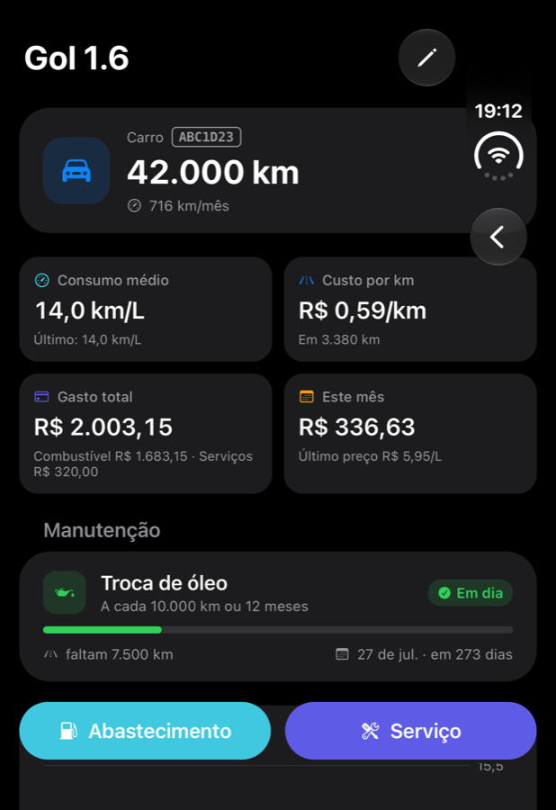
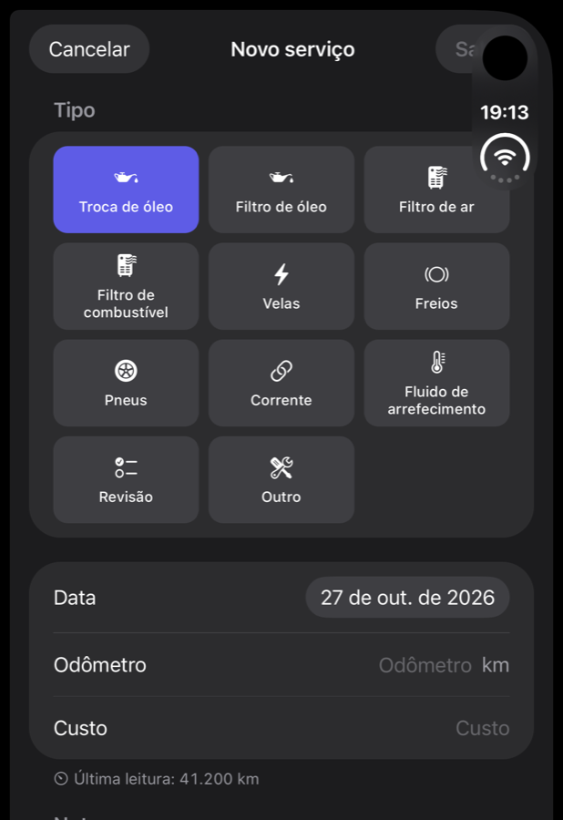
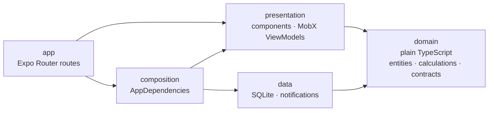

<div align="center">

# Kmais

**Car and motorcycle maintenance tracker in React Native: fuel log, real consumption, cost per km and service reminders.**

[](https://github.com/joaoduartemariucio/kmais-app-react-native/actions/workflows/ci.yml)


[](LICENSE)

`Clean Architecture` · `MVVM` · `Repository` · `SOLID` · `Dependency Injection` · `MobX` · `Expo Router` · `Jest` · `CI` · `AI agents`

</div>

<p align="center">
  
  
  
</p>

The React Native version of [kmais-app-ios](https://github.com/joaoduartemariucio/kmais-app-ios):
the same screens, features, domain rules, tests, agents and CI gates, with the architecture
translated to the stack the React Native community uses. How each piece maps is in
[decisions](docs/decisions.md#port-from-ios).

## Features

- **Vehicles** — cars and motorcycles, each with its own history and summary card.
- **Fuel log** — record fill-ups; consumption (km/L) is computed per interval between full tanks.
- **Anomaly detection** — flags entries that break the history (odometer going backwards or unchanged, non-positive liters, duplicates) so the stats can explain why a point was left out.
- **Cost** — total spent, fuel vs. service breakdown and cost per km.
- **Maintenance rules** — oil, filters, spark plugs, brakes, tires, chain, coolant, inspection; due by km and/or by time.
- **Forecast** — projects when the next service is due from the vehicle's own km/month pace.
- **Reminders** — local notifications at 9:00 on the day a service is due, kept in sync as
  you log fuel-ups and services, edit rules or archive a vehicle.
- **Timeline** — fuel and service entries grouped by month.
- Localized in **English and Portuguese (pt-BR)**, with locale-aware number input and units kept in km and liters.

## Architecture

A pragmatic take on **Clean Architecture**: **MVVM** in the presentation layer, the
**Repository** pattern for persistence and **SOLID** — dependency inversion above all — holding
it together. The layers live in a single Expo package, and their boundaries are enforced by
ESLint in CI.



| Layer                 | May depend on                                 | Never depends on                                        |
| --------------------- | --------------------------------------------- | ------------------------------------------------------- |
| `domain`              | TypeScript, `decimal.js`                      | React, React Native, Expo, MobX, `data`, `presentation` |
| `data`                | `domain`, `expo-sqlite`, `expo-notifications` | `presentation`, React                                   |
| `presentation`        | `domain`, React Native, MobX                  | `data`, `expo-sqlite`, `expo-notifications`             |
| `composition` / `app` | everything                                    | —                                                       |

### Patterns and where they live

| Pattern                  | Role                                                  | In the code                                                                                                                   |
| ------------------------ | ----------------------------------------------------- | ----------------------------------------------------------------------------------------------------------------------------- |
| **Clean Architecture**   | Business rules at the center, frameworks at the edges | `src/domain/` is plain TypeScript; SQLite and React Native stay in `src/data/` and `src/presentation/`                        |
| **MVVM**                 | Screen state and logic out of the views               | One MobX ViewModel class per screen (`VehicleDetailViewModel`, `FuelEntryFormViewModel`, …) rendered by `observer` components |
| **Repository**           | Persistence behind an interface                       | Contracts in `src/domain/repositories`, SQLite implementations in `src/data/repositories`                                     |
| **Mapper**               | Storage rows never leak                               | `src/data/mappers` turns SQLite rows into plain entities                                                                      |
| **Dependency Injection** | One composition root                                  | `src/composition/AppDependencies.ts` is the only place that creates concrete types, provided through React context            |

### SOLID in practice

- **S — Single responsibility:** one ViewModel per screen; calculations split by concern
  (`Consumption`, `Cost`, `Odometer`, `Maintenance`); mapping separated from persistence.
- **O — Open/closed:** new behavior is additive — e.g. live queries through `expo-sqlite`'s
  change listener will be a new repository method, with no existing signature changing.
- **L — Liskov substitution:** in-memory fake repositories replace the SQLite ones in tests,
  and the ViewModels can't tell the difference.
- **I — Interface segregation:** three small repository contracts (`VehicleRepository`,
  `FuelEntryRepository`, `ServiceRepository`) instead of one data manager.
- **D — Dependency inversion:** ViewModels and repositories both depend on abstractions owned
  by `domain`; nothing in `domain` knows SQLite or React exist.

### Pragmatic trade-offs

Clean Architecture sized for a one-developer app, on purpose:

- **No use-case layer** — most would be one-line pass-throughs; business rules live in
  `src/domain/calculations` and are tested there.
- **Layers as folders, not packages** — boundaries are guarded by lint instead of the module
  system; `domain` and `data` become workspace packages once a second target needs them.

Each trade-off, with what it costs and when to revisit it, is in [decisions](docs/decisions.md).

### Highlights

- **Pure, deterministic domain.** Consumption, cost, odometer and maintenance forecast are
  pure functions in `src/domain/calculations`. The forecast never reads the clock — the latest
  history point acts as "now", so the same history always yields the same prediction.
- **Money in `Decimal`** (`decimal.js`), never floating-point arithmetic.
- **SQLite stays behind a port.** Repositories depend on a five-method `SqlDatabase`
  interface: `expo-sqlite` in the app, `better-sqlite3` in the tests, same SQL and migrations.
- **Same numbers as the iOS app.** Every iOS test scenario is ported with the same dates and
  values, including the Foundation calendar rules (month clamping, whole days, 9:00 reminders).
- **Native look on both platforms** — iOS system colors and grouped lists, SF Symbols on iOS
  and Material Symbols on Android, both type-checked by `expo-symbols`.
- **Layer boundaries as lint rules.** Importing React Native or SQLite in `domain`, or a
  `data` module from `presentation`, fails the build:

```js
{
    files: ['src/presentation/**/*.{ts,tsx}'],
    rules: restrict('Presentation talks to Domain contracts only.', [
        ...layer('data'), ...layer('app'), ...layer('composition'), 'expo-sqlite', 'expo-notifications'
    ])
}
```

```
src/
├── app/            # Expo Router routes: _layout (root), index, archived, vehicles/[id]
├── composition/    # AppDependencies (only place that creates concrete types)
├── domain/
│   ├── entities/       # Vehicle, FuelEntry, ServiceEntry, ServiceRule, Calendar, ...
│   ├── calculations/   # Consumption, Cost, Odometer, Maintenance, ReminderPlan, anomalies
│   ├── repositories/   # contracts
│   └── services/       # ReminderScheduler, DateProvider (contracts)
├── data/
│   ├── database/       # SqlDatabase port, expo-sqlite adapter, KmaisSchema migrations
│   ├── mappers/        # row <-> entity
│   ├── repositories/   # SQLite implementations
│   └── services/       # expo-notifications, system clock
└── presentation/   # vehicles, fueling, maintenance, reminders, common (forms, formatting, validation), i18n
```

Design decisions are written down instead of commented in code:

- [Architecture](docs/architecture.md) — layers, data flow, lint rules and how to add a feature
- [Decisions](docs/decisions.md) — what was chosen, why, and what it costs
- [CI](docs/ci.md) — lint, format, build, test and coverage rules
- [AI agents](docs/agents.md) — the four specialized agents used to build the app, and why

## Testing

Tests use **Jest** through `jest-expo`:

- `test/calculations/` — consumption, anomalies, cost, odometer, maintenance forecast,
  reminders and the calendar, with fixtures.
- `test/presentation/` — ViewModels tested against in-memory fake repositories, plus the number
  mask, validation, formatting, chart math and the localization catalogs.
- `test/data/` — the SQLite repositories and migrations against an in-memory database.

## CI

Every push and pull request must pass, on GitHub Actions:

| Check        | Tool                                                          | Rule                                                                 |
| ------------ | ------------------------------------------------------------- | -------------------------------------------------------------------- |
| **Lint**     | ESLint (`eslint-config-expo`)                                 | zero problems, warnings included, including the layer-boundary rules |
| **Format**   | Prettier `--check`                                            | code matches the style in [`.prettierrc.json`](.prettierrc.json)     |
| **Build**    | `tsc --noEmit` + `expo export`                                | the project typechecks and bundles for iOS and Android               |
| **Test**     | `jest --coverage`                                             | every unit test passes                                               |
| **Coverage** | [`scripts/diff_coverage.py`](scripts/diff_coverage.py) + lcov | **≥ 80% of the changed executable lines** are covered                |

The coverage gate applies to **new code**: lines added or modified by the change, excluding
views, routes and native glue. Details, every rule and how to run each check locally are in
[docs/ci.md](docs/ci.md).

## Getting started

Requirements: Node 22 ([`.nvmrc`](.nvmrc)); Xcode with an iOS Simulator, or Android Studio with
an emulator, to run the app.

```bash
git clone https://github.com/joaoduartemariucio/kmais-app-react-native.git
cd kmais-app-react-native
npm ci
npx expo run:ios
```

`EXPO_PUBLIC_PREVIEW_DATA=true npx expo run:ios` starts with two demo vehicles instead of the
on-device database. `npx expo run:android` runs it on Android.

Run the same checks as CI before pushing:

```bash
make ci
```

## Roadmap

- Live queries through `expo-sqlite`'s change listener behind the existing repository contracts, replacing reload-on-focus.
- Sync across devices.
- Promote `domain` and `data` to workspace packages once a second surface (widget, watch app, web) needs them.

## License

[MIT](LICENSE) © João Vitor Duarte Mariucio
