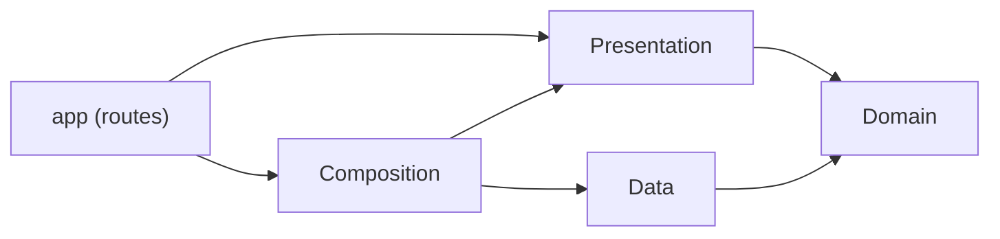

# Architecture

Kmais follows a pragmatic **Clean Architecture** with **MVVM** for screens, the **Repository**
pattern for persistence and **SOLID** principles — mainly dependency inversion. The
[README](../README.md#patterns-and-where-they-live) maps each pattern and principle to the
code; this document covers how the pieces work.

The app is a single Expo package split into five folders under `src/`. The split is by folder,
not by package, and the boundaries between them are enforced by ESLint.

| Folder              | What lives there                                                 | May use                                       | Must not use                                                      |
| ------------------- | ---------------------------------------------------------------- | --------------------------------------------- | ----------------------------------------------------------------- |
| `src/domain/`       | Entities, calculations, repository and service contracts, errors | TypeScript, `decimal.js`                      | React, React Native, Expo, MobX, i18next, `data`, `presentation`  |
| `src/data/`         | SQLite schema, mappers, repositories, platform services          | `domain`, `expo-sqlite`, `expo-notifications` | `presentation`, `app`, React                                      |
| `src/presentation/` | Views, MobX ViewModels, form helpers, i18n                       | `domain`, React Native, MobX, Expo UI modules | `data`, `app`, `composition`, `expo-sqlite`, `expo-notifications` |
| `src/composition/`  | `AppDependencies`                                                | everything                                    | —                                                                 |
| `src/app/`          | Expo Router routes and the root layout                           | `presentation`, `composition`                 | —                                                                 |

## Domain

Immutable objects and pure functions — no React, no I/O.

- **Entities** — `Vehicle`, `FuelEntry`, `ServiceEntry`, `ServiceRule`, `OdometerSample`, each
  with a `make…` function that fills the same defaults as the iOS initializers, and `Calendar`
  (UTC or device-local calendar arithmetic, the counterpart of Foundation's `Calendar`).
- **Calculations** — one namespace per concern, each with its own tests:
    - `Consumption` — km/L per interval between two full tanks, plus `anomalies`
      (odometer going backwards or unchanged, non-positive liters, duplicates).
    - `Cost` — fuel and service totals, cost per km.
    - `Odometer` — current reading, the full reading history of a vehicle, and
      `neighbors` (the readings right before and after a date).
    - `Maintenance` — km/month pace, next service date and odometer for a rule, and
      `status` (on track / due soon / overdue, with progress).
    - `ReminderPlan` — when to notify for each rule: 9:00 on the due day, or the next 9:00 when overdue.
- **Contracts** — `VehicleRepository`, `FuelEntryRepository`, `ServiceRepository`,
  `DateProvider`, `ReminderScheduler`. Everything async and returning entities.

Calculations never read the clock: "now" is either passed in or taken from the latest
reading, so the same input always gives the same output.

## Data

- `database/` — `SqlDatabase` is a five-method port (`exec`, `run`, `getAll`, `getFirst`,
  `transaction`). `ExpoSqlDatabase` implements it with `expo-sqlite` in the app;
  `test/data/BetterSqliteDatabase.ts` implements it with `better-sqlite3` in tests, so the same
  repositories and migrations run in both. `KmaisSchema` holds the migrations and tracks the
  version in `PRAGMA user_version`; foreign keys are on, with `ON DELETE CASCADE` from each
  record to its vehicle. Money is stored as text so `Decimal` round-trips exactly; dates as
  milliseconds since the epoch.
- `mappers/` — row ⇄ entity. Rows never leave `data/`. An unknown `kind` reads back as the
  default (`car`, `other`) instead of failing the whole list.
- `repositories/` — one class per contract (`SqliteVehicleRepository`, …). Every database error
  is wrapped in `RepositoryError.persistenceFailed`; writes that need a vehicle check it first and
  throw `vehicleNotFound`, deletes of a missing row throw `entryNotFound`.
- `services/` — `SystemDateProvider` and `ExpoNotificationReminderScheduler`.
- `PreviewData.ts` — demo records for screenshots, seeded only with `EXPO_PUBLIC_PREVIEW_DATA=true`.

## Presentation

One ViewModel per screen: a MobX class (`makeAutoObservable`) depending only on Domain
contracts. Views are `observer` components; they create their ViewModel once with `useState`
and read dependencies from `useDependencies()`.

- **Lists and detail** load in `useFocusEffect` — on first show and every time the screen comes
  back — and reload after each write. `state` is a discriminated union (`loading`, `loaded`,
  `failed`) replaced as a whole, so nothing renders a half-updated screen.
- **Forms** (`VehicleForm`, `FuelEntryForm`, `ServiceEntryForm`) follow the same shape:
    - fields kept as `string` so "empty" and "zero" are different states;
    - `issues: ValidationIssue[]` computed from the fields. Issues are either **blocking**
      (red, disable Save) or **warnings** (orange, informative only);
    - `FormState` (`editing`, `saving`, `saved`, `failed`) drives the sheet header.
    - They open as native page sheets (`Modal` with `presentationStyle="pageSheet"`) from the
      screen that owns them, which reloads in `onSaved` — the same flow as SwiftUI's `.sheet`.
- **Common helpers** (`presentation/common/`):
    - `LabeledNumberField` + `NumberInputStyle` — masked numeric input (see
      [decisions](decisions.md#numeric-fields-are-digit-shifting-masks)).
    - `ValidationFooter` — renders issues with the right color and icon.
    - `FormatStyles` — km, liters, km/L, currency and dates, formatted with `Intl` for the device locale.
    - `Palette` — iOS system colors for light, dark and elevated (sheet) surfaces, category colors
      (fuel, service) and status colors; `Display` has labels and symbols.
    - `Symbols` — every icon as an SF Symbol name for iOS and a Material Symbol name for Android,
      both type-checked by `expo-symbols`.
    - `SymbolBadge`, `MetricTile`, `StatusCapsule`, `ProgressBar`, `GroupedList` — shared
      building blocks of the cards and grouped lists.
    - `FormSheet` + `KeyboardDone` — keyboard closes on drag, on tap outside a field, or with "Done".
- **Vehicle dashboard** — `VehicleStats` gathers everything a card shows (consumption history,
  km/L per closing fill-up, this month's spending, every reminder with its status);
  `VehicleTimeline` groups the history by month, filters it and builds the spending chart data.
  The charts are drawn with `react-native-svg`; `ChartGeometry` has their tested math (ticks,
  monotone line).
- **Reminders** — `ServiceReminderSync` re-plans service notifications at the end of the
  list and detail `load()`: it gathers each active vehicle's records, asks
  `ReminderPlan.reminders` (Domain) when each rule is due, cancels stale notifications and
  schedules the rest through `ReminderScheduler`. See [decisions](decisions.md#reminders).
- **i18n** — an `i18next` instance with the English and Portuguese catalogs, keyed by the English
  text; `t()` is called from views, ViewModels and helpers alike.

## Composition and app

`AppDependencies` is the only place that creates concrete types. It implements the
`Dependencies` interface that presentation consumes through `DependenciesProvider`, and has
three flavors: `live()`, `inMemory()` for tests and an automatic in-memory fallback if the
on-disk database fails to open, plus `preview()` with demo data.

`src/app/` is Expo Router's routes folder: `_layout.tsx` (the root: providers, theme, native
stack), `index.tsx` (vehicles), `archived.tsx` and `vehicles/[id].tsx`, which looks the vehicle
up by id and shows its dashboard. `presentation/navigation/AppRoute` builds the links.

## Data flow

**Read:** screen gains focus → ViewModel calls repository contracts → repository runs SQL and
maps rows to entities → ViewModel runs Domain calculations (`VehicleStats`, `VehicleTimeline`)
and replaces its state → `observer` view re-renders.

**Write:** form builds an entity → repository upserts it by `id` → sheet dismisses → parent
ViewModel reloads.

## Enforcement

`eslint.config.js` adds `no-restricted-imports` rules per folder on top of `eslint-config-expo`,
all errors:

| Folder              | Fails when it imports                                                                 |
| ------------------- | ------------------------------------------------------------------------------------- |
| `src/domain/`       | another layer, React, React Native, Expo, MobX or i18next                             |
| `src/data/`         | `presentation`, `app`, `composition`, React, MobX or i18next                          |
| `src/presentation/` | `data`, `app`, `composition`, `expo-sqlite`, `expo-notifications` or `better-sqlite3` |

The rules match both `@/…` aliases and relative paths, so a `../../data/…` import fails too.
CI runs them with the format check, typecheck, bundle, tests and the coverage gate. See [CI](ci.md).

## Tests

Jest through `jest-expo`, in `test/`:

- `calculations/` — every Domain calculation and the `Calendar`, with shared fixtures (`day()`,
  `sample()`, `full()`, …). `day(n)` counts from 2001-01-01 UTC, Foundation's reference date,
  so the scenarios are the iOS ones, number for number.
- `presentation/` — ViewModels against in-memory fakes (`fakes/InMemoryRepositories.ts`,
  `FixedDateProvider`), plus the number mask, validation, formatting, chart math and the
  localization catalogs.
- `data/` — the SQLite repositories and migrations against an in-memory database.

## Adding a feature

1. **Domain:** add or extend the entity and write the calculation as a pure function, with tests.
2. **Domain:** if it needs storage, add the method to the repository contract.
3. **Data:** implement it in the SQLite repository with tests in `test/data/`; a new column or
   table is a new migration appended to `KmaisSchema`.
4. **Presentation:** ViewModel talks to the contract; test it with the in-memory fakes.
5. **Composition:** only touch `AppDependencies` if a new concrete type is needed.
6. Add user-facing strings to both locale files.
