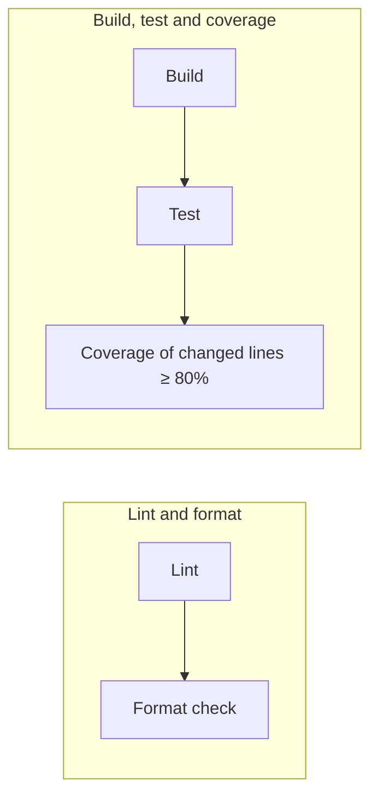

# CI

Every push and pull request runs [`.github/workflows/ci.yml`](../.github/workflows/ci.yml) on
GitHub Actions (`ubuntu-latest`, Node from [`.nvmrc`](../.nvmrc)). A change is mergeable only
when every check below passes.



The two jobs run in parallel. A newer push to the same branch cancels the run in progress.

## Rules

| Check        | Command             | Fails when                                                                       |
| ------------ | ------------------- | -------------------------------------------------------------------------------- |
| **Lint**     | `make lint`         | any ESLint problem, warnings included (`--max-warnings 0`)                       |
| **Format**   | `make format-check` | any file differs from what Prettier would produce                                |
| **Build**    | `make build`        | TypeScript does not typecheck, or Metro cannot bundle the app for iOS or Android |
| **Test**     | `make test`         | any unit test fails                                                              |
| **Coverage** | `make coverage`     | less than **80%** of the changed executable lines are covered by tests           |

### Lint — ESLint

Config: [`eslint.config.js`](../eslint.config.js). [`eslint-config-expo`](https://docs.expo.dev/guides/using-eslint/)
— the React, React Hooks, import and TypeScript rules Expo recommends — plus one
`no-restricted-imports` rule per layer that keeps the layers apart:

| Folder              | Fails when it imports                                                                 |
| ------------------- | ------------------------------------------------------------------------------------- |
| `src/domain/`       | another layer, React, React Native, Expo, MobX or i18next                             |
| `src/data/`         | `presentation`, `app`, `composition`, React, MobX or i18next                          |
| `src/presentation/` | `data`, `app`, `composition`, `expo-sqlite`, `expo-notifications` or `better-sqlite3` |

`eslint-config-prettier` turns off every stylistic rule, so ESLint and Prettier never disagree.

### Format — Prettier

Config: [`.prettierrc.json`](../.prettierrc.json). [Prettier](https://prettier.io)'s defaults —
the most widely used baseline in the JavaScript community — with a few options pinned:

| Option                  | Value          | Why                                                                |
| ----------------------- | -------------- | ------------------------------------------------------------------ |
| Indentation / max width | 4 spaces / 120 | same as the iOS project; JSON and YAML keep 2 spaces               |
| Quotes                  | single         | the React Native community default (`@react-native/eslint-config`) |
| Trailing commas         | none           | same diff shape as the iOS project                                 |

Run `make format` to fix everything at once.

### Build

`make build` typechecks the whole project (`tsc --noEmit`, `strict` and
`noUncheckedIndexedAccess` on), then bundles the JavaScript for iOS and Android with
`expo export`, the same Metro build a release uses. Symbol names are part of the typecheck:
`expo-symbols` types every SF Symbol and Material Symbol name, so a typo fails here.

Native builds (`expo run:ios`, EAS) are not part of CI: the native projects are generated from
`app.json` (Continuous Native Generation) and contain no code of this repository.

### Test

`make test` runs Jest with coverage (`jest --coverage --ci`) and writes `coverage/lcov.info`.
CI uploads that file as an artifact.

### Coverage of changed lines

The rule is about **new code**, not the whole project: of the executable lines added or
modified by the change, at least **80%** must run during the tests.

[`scripts/diff_coverage.py`](../scripts/diff_coverage.py):

1. diffs the change against its base, ignoring whitespace-only edits:
    - **pull request** → the PR's base commit;
    - **push** → the commit the branch was at before the push (`origin/main` for a new branch);
    - **locally** → `origin/main`, including uncommitted edits; files not yet added to git count in full;
2. reads per-line execution counts from `coverage/lcov.info`;
3. keeps only executable lines (comments, braces and declarations never count) in files not
   listed in [`.coverageignore`](../.coverageignore);
4. fails if covered / executable < 80%, printing every uncovered line. In CI the same table
   appears in the run's summary.

A change with no executable lines (docs, views only, config) passes automatically.

#### What does not count

[`.coverageignore`](../.coverageignore) lists code with no logic of its own, which unit tests
can't meaningfully exercise:

- `src/app/` and `src/composition/` — routes, root layout and composition root;
- views, rows, cards and grids (`*View.tsx`, `*Row.tsx`, `*Card.tsx`, `*Grid.tsx`) and the
  shared components in `presentation/common/components/`;
- `Palette.ts`, `ActionMenu.ts`, the dependency context and `AppRoute` — styling and wiring;
- `ExpoSqlDatabase.ts` and `ExpoNotificationReminderScheduler.ts` — glue to native modules that
  only run on a device. The repositories and migrations above them are tested against
  `better-sqlite3`.

**ViewModels, Domain and Data always count.** Logic in a view belongs in its ViewModel,
where it can be tested.

## Running it locally

```bash
npm ci
make ci
```

`make ci` runs the same steps as CI in order. Each one also runs on its own:

| Command             | What it does                                                                               |
| ------------------- | ------------------------------------------------------------------------------------------ |
| `make lint`         | ESLint, zero warnings                                                                      |
| `make format`       | formats the code in place                                                                  |
| `make format-check` | fails if anything would be reformatted                                                     |
| `make typecheck`    | TypeScript only                                                                            |
| `make build`        | typecheck + bundles the app for iOS and Android                                            |
| `make test`         | runs the unit tests with coverage                                                          |
| `make coverage`     | checks changed lines against `origin/main`; `BASE=<ref>` or `MIN_COVERAGE=<n>` to override |
| `make clean`        | removes `.build/`, `coverage/` and `.expo/`                                                |
